<p align="center">
  
</p>

# Cipher

Edge-native runtime supervision, persistent memory indexing, and security boundaries for local AI execution.

Cipher packages an 8-service local AI infrastructure into a single standalone Go binary. It provides credential redaction, kernel-level execution timeouts, vector memory lookup, and cryptographic audit logging over Unix domain sockets behind a single HTTP port.

Looking for a plain-English, non-technical summary? See [EXPLAINER.md](EXPLAINER.md).

---

## Technical Invariants

* **Zero external runtime dependencies**: The entire cluster is written in Go. No Docker daemon, Python virtual environments, or Node.js runtime required on the host.
* **Single-port ingress**: The cluster exposes port `8080`. All internal communication between the 8 services runs over Unix domain sockets in `/tmp/cipher/*.sock` with `0600` file permissions.
* **Kernel execution boundaries**: Code execution runs inside Apple Seatbelt profiles on macOS and Linux namespaces/cgroups, enforcing network isolation and a hard 3-second process termination ceiling.
* **Cryptographic integrity**: Telemetry and incident events are committed to an append-only SQLite WAL ledger and chained into a SHA-256 Merkle tree.
* **Local-first authentication**: Generates a 256-bit cryptographic token in `~/.cipher/token` (`0600` permissions) on initial startup. HTTP routes require `Authorization: Bearer <token>`.

---

## Installation

### Homebrew (macOS / Linux)

```bash
brew install sshloktiwarii/tap/cipher
```

### Install Script

```bash
curl -fsSL https://raw.githubusercontent.com/sshloktiwarii/cipher-cli/master/scripts/install.sh | bash
```

### Build from Source

Requires Go 1.22+.

```bash
git clone https://github.com/sshloktiwarii/cipher-cli.git
cd cipher-cli
go build -o cipher .
```

---

## Usage

### Start Appliance

Boots all 8 services in a single supervised process:

```bash
cipher appliance
```

Outputs:

```text
==================================================
CIPHER APPLIANCE SUPERVISOR
==================================================
✓ Socket cage: /tmp/cipher (0700)
✓ Started cipher-log     -> /tmp/cipher/log.sock (0600)
✓ Started cipher-sec     -> /tmp/cipher/sec.sock (0600)
✓ Started cipher-mem     -> /tmp/cipher/mem.sock (0600)
✓ Started cipher-exec    -> /tmp/cipher/exec.sock (0600)
✓ Started cipher-mcp     -> /tmp/cipher/mcp.sock (0600)
✓ Started cipher-core    -> /tmp/cipher/core.sock (0600)
✓ Started cipher-route   -> http://localhost:8080

Appliance running (boot time: 38ms)
• Ingress:      http://localhost:8080
• Web HUD:      http://localhost:8080/hud
• Cluster:      http://localhost:8080/cluster/status
• Audit Proof:  http://localhost:8080/verify-audit-chain
==================================================
```

### Run Synthetic Integration Tests

Runs the 4-gate verification suite against the running cluster:

```bash
cipher test
```

Verification assertions:
* Gate 1: `cipher-sec` catches AWS credentials and redacts them in $<2\text{ms}$.
* Gate 2: `cipher-exec` terminates a runaway computation in $\le 3003\text{ms}$ with exit code `-1`.
* Gate 3: `cipher-mem` matches incident post-mortems via vector similarity in $<1\text{ms}$.
* Gate 4: `cipher-log` confirms SHA-256 Merkle chain integrity without tampering.

### Update Binary

Checks GitHub Releases, verifies the SHA-256 manifest, and swaps the binary in place:

```bash
cipher update
```

---

## Architecture

```text
                     Client / Agent (Claude, Cursor, CLI)
                                      |
                           HTTP :8080 (Bearer Token)
                                      v
                                 cipher-route
                     (Ingress Proxy, Semantic Cache, Auth)
                                      |
         +----------------+-----------+-----------+----------------+
         |                |                       |                |
  /tmp/cipher/        /tmp/cipher/            /tmp/cipher/     /tmp/cipher/
    sec.sock            exec.sock               mem.sock         log.sock
         |                |                       |                |
         v                v                       v                v
    cipher-sec       cipher-exec             cipher-mem       cipher-log
   (Firewall &       (Seatbelt &             (Obsidian &      (Merkle &
    Redaction)        Sandbox)              Vector Search)    SQLite WAL)
                          ^                       ^
                          |                       |
                          +-----------+-----------+
                                      |
                                 cipher-core
                        (Self-Healing State Machine)
                                      |
                          /tmp/cipher/mcp.sock
                                      v
                                 cipher-mcp
                           (Go MCP JSON-RPC Server)
```

---

## Cluster Services

All 8 services are standalone Go repositories:

| Service | Repository | Role |
| :--- | :--- | :--- |
| `cipher-cli` | [sshloktiwarii/cipher-cli](https://github.com/sshloktiwarii/cipher-cli) | Supervisor, CLI commands, self-update engine |
| `cipher-route` | [sshloktiwarii/cipher-route](https://github.com/sshloktiwarii/cipher-route) | HTTP ingress gateway, semantic cache, circuit breaker |
| `cipher-sec` | [sshloktiwarii/cipher-sec](https://github.com/sshloktiwarii/cipher-sec) | Regex and Shannon entropy secret redaction |
| `cipher-exec` | [sshloktiwarii/cipher-exec](https://github.com/sshloktiwarii/cipher-exec) | Seatbelt/namespace sandbox with 3s hard kill ceiling |
| `cipher-mem` | [sshloktiwarii/cipher-mem](https://github.com/sshloktiwarii/cipher-mem) | Obsidian vault parser, vector index, cosine similarity |
| `cipher-log` | [sshloktiwarii/cipher-log](https://github.com/sshloktiwarii/cipher-log) | High-throughput telemetry and Merkle audit chain |
| `cipher-mcp` | [sshloktiwarii/cipher-mcp](https://github.com/sshloktiwarii/cipher-mcp) | Model Context Protocol JSON-RPC 2.0 tool provider |
| `cipher-core` | [sshloktiwarii/cipher-core](https://github.com/sshloktiwarii/cipher-core) | 5-stage self-healing state machine |

---

## Command Reference

| Command | Description |
| :--- | :--- |
| `cipher appliance` | Starts all 8 cluster services under supervised process management. |
| `cipher test` | Runs the 4-gate integration suite against the active cluster. |
| `cipher update` | Checks GitHub Releases and performs an in-place binary update. |
| `cipher doctor` | Audits port availability, socket paths, and host memory. |
| `cipher status` | Checks health and connection mode for all services. |
| `cipher halt` | Reaps child processes and clears socket files. |

---

## License

MIT License. Copyright (c) 2026 Shlok Tiwari.
